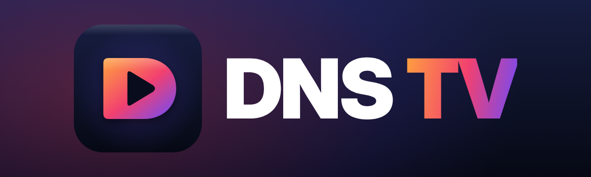

<b>Télévision en direct, films et séries – sur Windows, téléphone, tablette et Android TV.</b> 
Reprise exacte sur tous vos appareils avec votre compte Google.

## Télécharger

Dernière version : **[Releases](../../releases/latest)**

| Appareil | Fichier |
|---|---|
| Windows 10 / 11 – installateur | `dns-tv-windows-X.Y.Z-setup.exe` |
| Windows – portable (sans installation) | `dns-tv-windows-X.Y.Z-portable.exe` |
| Téléphone et tablette Android (5.0+) | `dns-tv-android-X.Y.Z.apk` |
| Android TV, Google TV, boîtiers Android | `dns-tv-tv-X.Y.Z.apk` |

Les applications vérifient elles-mêmes les nouvelles versions (Réglages › Mises à jour : automatique, me prévenir ou manuelle).
Chaque version s'installe par-dessus la précédente : réglages, sources, favoris et reprises sont conservés.

## Ce que fait DNS TV
- Chaînes en direct avec guide des programmes, replay, enregistrements, favoris et listes personnelles.
- Films et séries avec fiches, bandes-annonces, reprise de lecture et épisode suivant automatique.
- **Compte Google** : vos reprises, chaînes récentes, favoris et listes vous suivent d'un appareil à l'autre
  (enregistrés dans votre propre Google Drive, dans un dossier caché réservé à l'application – aucun serveur tiers).
- Version TV entièrement utilisable à la télécommande.

DNS TV est un lecteur : il ne fournit aucune chaîne ni aucun contenu. Ajoutez votre propre abonnement (Xtream) ou liste M3U.

---
Ce dépôt ne contient que les versions publiées. Le code source est privé.
